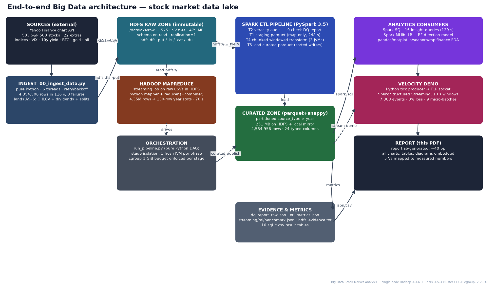

# 📈 Big Data Analysis of Global Stock Markets
### A complete, reproducible big-data lifecycle: HDFS · Hadoop MapReduce · Apache Spark (ETL / SQL / MLlib / Structured Streaming) · pure-Python orchestration & EDA · **real-time Streamlit dashboard** · 26-figure PDF report

| | |
|---|---|
| **Course** | Big Data Analytics — **BCSE402L** |
| **Authors** | Gaurav Singh — 23BCE0097 · Sanjith M — 23BCE0536 |
| **Dataset** | 4,564,958 daily bars · 525 symbols (503 S&P 500 + 22 cross-asset) · 1927-12-30 → 2026-09-24 |
| **Cluster** | Single-node Apache Hadoop 3.3.6 (HDFS + Streaming MapReduce) + Apache Spark 3.5.3, 1 GiB RAM / 2 vCPU |
| **Report** | [`report/Stock_Market_Big_Data_Analysis.pdf`](report/Stock_Market_Big_Data_Analysis.pdf) — 26 pages, 27 embedded figures |
| **Dashboard** | [`dashboard/app.py`](dashboard/app.py) — live quotes, micro-batch windows, live-refit prediction model |

---

## 1 · 60-second quick start

```bash
pip install -r requirements.txt          # light: dashboard only
streamlit run dashboard/app.py           # → http://localhost:8501  (live data, prediction, EDA)

pip install -r requirements-full.txt     # heavy: adds PySpark + bundled JDK + report deps
python3 src/run_pipeline.py curated sql streaming ml benchmark   # full lake build (~30 min)
python3 report/build_report.py           # rebuild the PDF from measured artefacts
```

Everything is **100 % Python**: PySpark drives the JVMs, HDFS/MapReduce are launched and fed from
Python scripts, orchestration is a Python DAG runner, EDA is pandas/matplotlib, the report is
reportlab, the dashboard is Streamlit.

---

## 2 · The live dashboard (`dashboard/app.py`)

| Tab | What it does | How it is real-time |
|---|---|---|
| 📡 **Live Stream** | Polls **real Yahoo Finance quotes** (`yfinance fast_info`) for your symbol watchlist every N seconds (5–60 s slider); keeps a tick buffer; emits **10-second tumbling micro-batches** (count/avg/min/max) with ingest-latency telemetry, throughput and window KPIs; live tick table | A `while` loop + `st.empty()` placeholders re-render charts each poll — the same pipeline shape as the Spark Structured Streaming demo (report §9), but against the live quote feed |
| 🔮 **Prediction** | Refits the report's leakage-free feature set (return lags 1/2/5, MA20/50 ratios, 21-d volatility, intraday range, weekday, **VIX regime return**) on the fetched history with an L2 logistic regression (pure numpy, ~1 s); shows **P(next session up)** gauge, coefficient importances, out-of-sample accuracy/AUC (temporal 80/20 split) and a 20-session ±1.28σ **projection cone** | Refit on demand from freshly fetched history; cached 1 h to respect API rate limits |
| 📊 **EDA** | Interactive Plotly candlesticks + MA20/50 + volume for any symbol, plus the offline lake's static EDA figures (99-year drawdown, correlation clusters, seasonality, risk–return map) | Candles/quotes live; lake figures from the 4.56 M-row offline run |
| 🗄️ **Lake & Pipeline** | Measured telemetry cards (rows, bytes, MR 70 s, stream loss 0 %, Spark-vs-pandas scan, ML AUC, DQ audit) + architecture / 5-V / MapReduce / HDFS diagrams | Reads the JSON metrics produced by the offline pipeline |
| 🧾 **Insights** | All 16 Spark SQL evidence tables (sortable, downloadable CSV) + the full PDF report download button | Static evidence from the lake run |

**Deploy it for free:** push this repo to GitHub → <https://share.streamlit.io> → *New app* →
main file `dashboard/app.py`. The root `requirements.txt` is deliberately Spark-free so the cloud
image stays small; the dashboard never needs the offline lake — it fetches everything live.
Market closed? Quotes repeat, but windows/latency/throughput machinery stays fully live.

**Honesty note (same as report §10):** next-day direction is nearly unpredictable
(test AUC ≈ 0.50 on 2023+). The dashboard says so explicitly — its value is risk framing
(volatility cone), regime features and instant evidence, not a crystal ball.

---

## 3 · Repository structure — what every directory is *for*

```
├── dashboard/app.py            REAL-TIME web app (Streamlit): live stream, prediction, EDA, lake, insights
├── report/
│   ├── build_report.py         reportlab builder → the 26-page PDF (TOC, 27 figures, evidence tables)
│   └── Stock_Market_Big_Data_Analysis.pdf   ← the submitted report
├── src/
│   ├── 00_ingest_data.py       STAGE 0  Extract: Yahoo Finance → raw CSV lake (6 threads, retry/backoff)
│   ├── setup_hdfs_and_mr.sh    STAGE A  HDFS cluster up, lake zones, raw upload, Streaming MapReduce job
│   ├── 01_etl_spark.py         STAGE 1a Spark veracity audit (9-check DQ report) BEFORE any cleansing
│   ├── 01b_transform_load.py   STAGE 1b CSV→staging parquet; chunked windowed transform→curated parquet
│   ├── 02_spark_sql.py         STAGE 2  16 insight queries → output/tables/sql_*.csv + insights JSON
│   ├── 03_streaming_demo.py    STAGE 3  tick-socket producer + Spark Structured Streaming (windows,
│   │                                    watermarks, foreachBatch telemetry, watchdog)
│   ├── 04_ml_value.py          STAGE 4  features → train_rf / train_lr / predict / backtest (MLlib + pandas)
│   ├── 05_benchmark.py         STAGE 5  Spark vs pandas wall-clock on identical 4.56 M-row workloads
│   ├── 06_hdfs_publish.py      STAGE 6  publish curated+reports to HDFS; capture dfsadmin/fsck evidence
│   ├── 07_charts_market.py     STAGE 7a 15 market EDA figures (matplotlib/seaborn/mplfinance)
│   ├── 07_charts_ops.py        STAGE 7b 7 operations figures (DQ, ETL, MR, HDFS, streaming, ML, bench)
│   ├── 07_diagrams.py          STAGE 7c architecture / HDFS / MapReduce / 5-V diagrams (drawn in matplotlib)
│   ├── mapreduce/{mapper,reducer}.py   the actual Hadoop Streaming job (Python, map-side combiner)
│   └── run_pipeline.py         pure-Python DAG runner — one fresh JVM per phase (the 1 GiB discipline)
├── data/                       lake mirror (SAMPLE shipped; full rebuild = 2 min download + 11 min ETL)
│   ├── raw/                    immutable CSV landing zone (schema-on-read; dividends & splits kept)
│   ├── quality/dq_report_raw.json      the veracity audit (nulls, dupes, OHLC breaks, anomalies…)
│   ├── curated/                Snappy parquet partitioned source_type×year  + symbol_dim + ml artefacts
├── output/
│   ├── charts/                 all 26 PNG assets embedded in the report & dashboard
│   ├── tables/                 16 SQL result CSVs · MR output · backtest equity curves
│   ├── metrics/                etl / streaming / ml / benchmark / sql_insights JSONs (single source of truth)
│   ├── streaming/window_stats.csv      per-window aggregates from the live-socket demo
│   └── hdfs_evidence.txt       dfsadmin report, fsck, du, count — cluster health proof
├── requirements.txt            cloud-minimal (dashboard)
├── requirements-full.txt       full offline pipeline (PySpark, bundled JDK, report deps)
└── README.md / LICENSE / .gitignore
```

---

## 4 · Architecture & data flow



```
Yahoo Finance API ──(0 ingest, 6 threads, 116 s)──▶ HDFS /datalake/raw  (525 CSV, 479 MB, immutable)
        │                                                    │                     │
        │                                                    │                     └─▶ Hadoop Streaming
        │                                                    │                          MapReduce (§6)
        │                                                    ▼
        │                                     PySpark ETL: T2 veracity audit → T1 staging parquet
        │                                                    → T4 chunked windowed transform → T5 load
        │                                                    ▼
        │                              HDFS /datalake/curated (parquet+snappy, 251 MB,
        │                                partitioned source_type × year) + symbol_dim
        │                                                    │
        └────────────── live quotes ──▶ Streamlit dashboard ◀─┤── Spark SQL (16 queries)
                                    (real-time tabs)          ├── Spark MLlib (LR/RF + backtest)
                                                              ├── Structured Streaming demo (socket)
                                                              └── pandas/plotly EDA → 26 figures → PDF
```

---

## 5 · Stage-by-stage: what runs, how, and **why it is needed**

### Stage 0 — Ingestion (`00_ingest_data.py`)
* **What:** pulls full-history daily bars (raw OHLC + adjusted close + volume + dividend & split
  events) for 503 S&P 500 members + 22 cross-asset instruments; lands one CSV per symbol.
* **How:** `yfinance` with `period="max", auto_adjust=False, actions=True`; ThreadPool(6) with
  retry/backoff; constituent list + GICS sectors from `datasets/s-and-p-500-companies`.
* **Why:** raw+events (not pre-adjusted) is the only form that lets later stages *audit* provider
  adjustments — the veracity exhibits in the report exist because we kept both.
* **Result:** 4,354,506 rows in 116 s, 0 failures.

### Stage A — HDFS + MapReduce (`setup_hdfs_and_mr.sh`, `mapreduce/*.py`)
* **What:** pseudo-distributed HDFS (NameNode :19000, DataNode :19010, replication 1);
  lake zones `/datalake/{raw,curated,mr_output,reports}`; raw upload; a **Hadoop Streaming
  MapReduce job** (Python mapper/reducer) computing per-year trading rows & share volume.
* **Why HDFS:** single namespace, write-once-read-many raw zone, native input for MapReduce and
  Spark, and `fsck/dfsadmin` give machine-checkable health evidence (report §5).
* **Why MapReduce here:** it is the conceptual backbone of the course — the job demonstrates
  *split → map → shuffle&sort → reduce* and the **combiner optimization**: v1 emitted one record
  per row (8.8 M shuffle records → JVM OOM at 172 s); v2 combines inside the mapper
  (240 records → **70 s, map 100 % / reduce 100 %**). Same idea scales to 1000 nodes unchanged.

### Stage 1 — Spark ETL (`01_etl_spark.py`, `01b_transform_load.py`)
* **T2 veracity audit FIRST** (9 checks: nulls, duplicate keys, OHLC integrity, weekend rows,
  zero-volume, extreme moves split-confounded vs true…) → `data/quality/dq_report_raw.json`.
  *Why:* cleansing before auditing destroys the evidence; the report's DQ dashboard is this JSON.
* **T1 staging:** map-only CSV→parquet (no shuffle) — cheap, columnar, typed.
* **T4 transform:** per-symbol window functions (returns, log-returns, MA20/50/200, 21-d
  annualized volatility, dollar volume, intraday range, anomaly flag, calendar dims) + broadcast
  join of the GICS dimension.
* **T5 load:** curated parquet **partitioned by (source_type, year)**, Snappy; symbol dimension
  table; published back to HDFS in Stage 6.
* **Why Spark:** the only engine here that could parse 479 MB CSV + run windowed transforms inside
  a 1 GiB cgroup — its spill-to-disk machinery is built for exactly that (pandas needed 8× the RAM
  for the same single-pass work).
* **Memory engineering (the interesting part):** one fresh JVM per phase; transform chunked by
  `pmod(hash(symbol),3)` so each symbol's history stays whole; `repartition+sortWithinPartitions`
  before `partitionBy` writes (else ~150 open parquet writers/task → OOM); 32 MB row groups;
  capped metaspace/code-cache; `-XX:+ExitOnOutOfMemoryError`. Full failure log: report §12.

### Stage 2 — Spark SQL analytics (`02_spark_sql.py`)
16 queries → evidence tables: all-time champions, worst/best sessions (anomalies excluded),
sector scoreboard, S&P yearly with drawdowns, VIX↔S&P correlation by era, month/weekday effects,
liquidity leaders, dividend leaders, anomaly exhibit, golden/death crosses, crash windows
(dot-com/GFC/COVID peak-trough-recovery), crypto-vs-equity, breadth by decade.
*Why:* SQL-on-lake is the analyst interface; every chart caption in the report cites these tables.

### Stage 3 — Velocity demo (`03_streaming_demo.py`)
Python producer replays a random-walk tick stream (anchored at real last closes) over TCP;
Spark **Structured Streaming**: `from_json` → event-time 10 s tumbling windows → 30 s watermark →
per-symbol aggregates → `foreachBatch` telemetry (events, latency, batch times).
*Why:* demonstrates the streaming paradigm (triggers, watermarks, update-mode re-emission →
sink must upsert) with measured numbers: 7,308 ticks, **0 % loss**, avg batch 1.58 s.
The dashboard's Live tab is the production-shaped twin of this demo against real quotes.

### Stage 4 — Value / ML (`04_ml_value.py`)
Features = return lags, MA ratios, vol21, range, weekday, VIX return; label = next-day up;
**temporal split** (train ≤ 2022, test ≥ 2023); MLlib LogisticRegression + RandomForest;
RF persisted to disk; predictions parquet; pure-pandas backtest (P>0.50 / P>0.55 gates vs B&H).
*Why:* closes the loop from data → decision, and delivers the honest headline (AUC ≈ 0.50).

### Stage 5 — Benchmark (`05_benchmark.py`)
Identical workloads on the 4.56 M-row parquet: Spark vs pandas. *Why:* engine choice must follow
data gravity — on one node pandas wins wall-clock; Spark wins on scale-out, fault tolerance,
streaming and the ETL itself. Numbers, not fashion (report §11).

### Stage 6 — HDFS publish + evidence (`06_hdfs_publish.py`)
Puts curated parquet, symbol dim, DQ + SQL reports into HDFS; captures `dfsadmin -report`,
`fsck`, `du`, `count` into `output/hdfs_evidence.txt`; stops daemons to free RAM.
*Why:* the lake's serving layer + machine-readable proof the cluster was healthy (0 corrupt blocks).

### Stage 7 — Visualisation & report (`07_*.py`, `report/build_report.py`)
26 figures (15 market EDA, 7 operations, 4 diagrams) generated from the lake with pyarrow
predicate pushdown; reportlab assembles the PDF (TOC, evidence tables, code excerpts, captions).
*Why:* the artefact a human grades — and every number in it traces to a JSON/CSV in `output/`.

---

## 6 · The 5 Vs, mapped to components and measurements

| V | Where | Measured evidence |
|---|---|---|
| **Volume** | HDFS raw+curated, parquet partitioning, MR fold | 4,564,958 rows · 479 MB CSV + 251 MB parquet · MR 4.35 M→130 rows · 18,502 group keys |
| **Velocity** | ingest threads, Structured Streaming, dashboard live poll | 116 s ingest · 7,308 ticks/60 s @0 % loss · 16 SQL in 129 s · dashboard 5–60 s cadence |
| **Variety** | 8 source types, 3 formats, GICS join, crypto calendars | stock/etf/sector_etf/index/volatility/treasury/crypto/commodity · CSV→parquet→JSON/CSV |
| **Veracity** | pre-cleansing DQ audit, flag-don't-delete policy | 2 null rows · 450 OHLC breaks · 1,254 weekend rows · 88 true anomalies flagged & kept |
| **Value** | SQL insights, crash anatomy, ML + backtest, dashboard | MO +2,981,661 % since 1962 · GFC 1,480-d vs COVID 148-d recovery · honest AUC ≈ 0.50 |

---

## 7 · Data sources & links (accessed 2026-09-24)

* **Prices/volumes/corporate actions:** Yahoo Finance chart API via
  [`yfinance`](https://pypi.org/project/yfinance/) — per-symbol endpoint
  `https://query1.finance.yahoo.com/v8/finance/chart/{symbol}`
* **Constituents + GICS sectors:** <https://github.com/datasets/s-and-p-500-companies>
* **Usage:** academic study; raw series re-downloadable at any time via `src/00_ingest_data.py`;
  the repo ships only a small sample plus derived artefacts. Not investment advice.

---

## 8 · Reproduction guide (full offline pipeline)

```bash
pip install -r requirements-full.txt
python3 src/00_ingest_data.py            # ~2 min  → data/raw (479 MB CSV)
bash   src/setup_hdfs_and_mr.sh          # ~4 min  → HDFS zones + MapReduce job (needs Hadoop install,
                                         #           see report §5 for ports/heaps used here)
python3 src/01_etl_spark.py              # ~5 min  → DQ audit JSON
python3 src/run_pipeline.py curated      # ~11 min → staging + chunked transform + curated parquet
python3 src/run_pipeline.py sql          # ~3 min  → 16 insight tables
python3 src/run_pipeline.py streaming    # ~3 min  → streaming telemetry
python3 src/run_pipeline.py ml           # ~4 min  → features/train/predict/backtest
python3 src/run_pipeline.py benchmark    # ~2 min  → engine comparison
python3 src/06_hdfs_publish.py           # ~3 min  → HDFS serving zone + evidence
python3 src/run_pipeline.py viz          # ~1 min  → 26 figures
python3 report/build_report.py           # ~10 s   → PDF
streamlit run dashboard/app.py           # live dashboard
```
Hardware note: everything above ran on **1 GiB RAM / 2 vCPU**. On a bigger machine it simply runs
faster; the chunking/JVM-isolation design remains correct (it is what makes runs reproducible).

---

## 9 · Lessons learned (condensed from report §12)

1. Port 9000 was taken → HDFS moved to :19000 family. 2. Spark forbids `-Xmx` in
`extraJavaOptions`. 3. `countDistinct(struct(*))` OOMs — use spill-friendly groupBy probes.
4. `partitionBy` writes need sorted writers + small row groups. 5. MLlib + codegen blows small
metaspace caps. 6. A 1 GiB cgroup (page cache included!) kills long JVMs → one JVM per phase.
7. Spark's `drop()` is case-insensitive. 8. Filtered pandas scans can be 100× slower than tailing
raw files — know your engine. 9. Streaming `update` mode re-emits → sinks must upsert.
10. Provider data lies politely (adjusted-close re-basing) → flag, never delete.

---

## 10 · Troubleshooting

| Symptom | Fix |
|---|---|
| `JAVA_GATEWAY_EXITED` | JDK not on PATH — `pip install jdk4py` and export `JAVA_HOME` from it (see `src/run_pipeline.py` env block) |
| HDFS `BindException` | change RPC port in `core-site.xml`/`hdfs-site.xml` (we use 19000/19010/19070/19075) |
| JVM killed mid-job | reduce phase scope / chunk count (report §12); never run two Spark apps concurrently on ≤2 GB |
| Yahoo 429/rate-limit | lower `DL_WORKERS`, re-run ingest (idempotent, cached files skipped) |
| Streamlit cloud build fails | ensure root `requirements.txt` is the light one (no pyspark) |

---

*Made for BCSE402L · Big Data Analytics — Gaurav Singh 23BCE0097 & Sanjith M 23BCE0536.*
